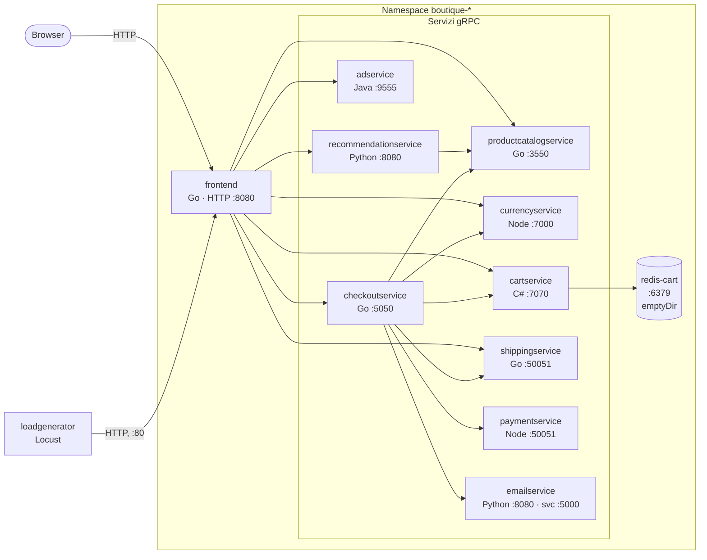

# Architettura di Online Boutique

Analisi dell'applicazione (fase 1). Tutto ciò che è scritto qui deriva dalla **lettura statica** di manifest (`kustomize/base`, `kustomize/components/network-policies`), `protos/demo.proto` e codice in `src/`, riferita al commit `81b1c6c7`. Nulla è stato ancora osservato a runtime: i punti che richiedono una prova nel cluster sono raccolti in [Da verificare a runtime](#da-verificare-a-runtime).

## 1. Panoramica

Online Boutique è un negozio online di esempio. Il browser parla solo con il **frontend** (HTTP). Il frontend e il **checkoutservice** orchestrano 8 servizi gRPC. L'unico stato è il carrello, in **Redis**. Il catalogo e i tassi di cambio sono file statici dentro le immagini.

Il diagramma comprende solo i servizi della base Kustomize. `shoppingassistantservice` è escluso (vedi [sezione 5](#5-componenti-fuori-dalla-base)).

## 2. Servizi

Porte, linguaggi e risorse sono quelli dei manifest in `kustomize/base`. Le risorse sono nel formato *requests → limits*.

| Servizio | Linguaggio | Protocollo | Porta container → porta Service | CPU | Memoria |
|---|---|---|---|---|---|
| frontend | Go | HTTP (verso il browser), gRPC (client) | 8080 → 80 | 100m → 200m | 64Mi → 128Mi |
| productcatalogservice | Go | gRPC | 3550 → 3550 | 100m → 200m | 64Mi → 128Mi |
| currencyservice | Node.js | gRPC | 7000 → 7000 | 100m → 200m | 64Mi → 128Mi |
| cartservice | C# (.NET 10) | gRPC (server), RESP (client verso Redis) | 7070 → 7070 | 200m → 300m | 64Mi → 128Mi |
| recommendationservice | Python | gRPC | 8080 → 8080 | 100m → 200m | 220Mi → 450Mi |
| adservice | Java | gRPC | 9555 → 9555 | 200m → 300m | 180Mi → 300Mi |
| shippingservice | Go | gRPC | 50051 → 50051 | 100m → 200m | 64Mi → 128Mi |
| checkoutservice | Go | gRPC | 5050 → 5050 | 100m → 200m | 64Mi → 128Mi |
| paymentservice | Node.js | gRPC | 50051 → 50051 | 100m → 200m | 64Mi → 128Mi |
| emailservice | Python | gRPC | **8080 → 5000** | 100m → 200m | 64Mi → 128Mi |
| redis-cart | `redis:alpine` | RESP (TCP) | 6379 → 6379 | 70m → 125m | 200Mi → 256Mi |
| loadgenerator | Python (Locust) | HTTP (client) | nessuna | 300m → 500m | 256Mi → 512Mi |

Somma indicativa delle sole *requests* (calcolata a mano dai manifest): circa **1,6 vCPU** e **1,4 GiB** di memoria. Per i *limits* di memoria: circa 2,5 GiB.

**Attenzione alle porte.** `emailservice` è l'unico servizio con porta Service (5000) diversa da quella del container (8080). Il checkout lo raggiunge con `emailservice:5000`, mentre le NetworkPolicy aprono la porta **8080**, perché il filtro agisce sulla porta del pod. È un punto da ricordare in diagnosi.

Il frontend ha anche un secondo Service, `frontend-external` (tipo `LoadBalancer`, porta 80). Per l'ingresso da Traefik servirà solo il Service `frontend` (ClusterIP); `frontend-external` si può togliere negli overlay (fase 2-3).

## 3. Dipendenze

La colonna *Variabile* è il nome della variabile d'ambiente con l'indirizzo del servizio chiamato, come impostato nei manifest.

| Chiamante | Chiamato | Variabile (valore nella base) | RPC usate |
|---|---|---|---|
| frontend | productcatalogservice | `PRODUCT_CATALOG_SERVICE_ADDR` (`productcatalogservice:3550`) | ListProducts, GetProduct |
| frontend | currencyservice | `CURRENCY_SERVICE_ADDR` (`currencyservice:7000`) | GetSupportedCurrencies, Convert |
| frontend | cartservice | `CART_SERVICE_ADDR` (`cartservice:7070`) | GetCart, AddItem, EmptyCart |
| frontend | recommendationservice | `RECOMMENDATION_SERVICE_ADDR` (`recommendationservice:8080`) | ListRecommendations |
| frontend | adservice | `AD_SERVICE_ADDR` (`adservice:9555`) | GetAds |
| frontend | shippingservice | `SHIPPING_SERVICE_ADDR` (`shippingservice:50051`) | GetQuote |
| frontend | checkoutservice | `CHECKOUT_SERVICE_ADDR` (`checkoutservice:5050`) | PlaceOrder |
| checkoutservice | cartservice | `CART_SERVICE_ADDR` (`cartservice:7070`) | GetCart, EmptyCart |
| checkoutservice | productcatalogservice | `PRODUCT_CATALOG_SERVICE_ADDR` (`productcatalogservice:3550`) | GetProduct |
| checkoutservice | currencyservice | `CURRENCY_SERVICE_ADDR` (`currencyservice:7000`) | Convert |
| checkoutservice | shippingservice | `SHIPPING_SERVICE_ADDR` (`shippingservice:50051`) | GetQuote, ShipOrder |
| checkoutservice | paymentservice | `PAYMENT_SERVICE_ADDR` (`paymentservice:50051`) | Charge |
| checkoutservice | emailservice | `EMAIL_SERVICE_ADDR` (`emailservice:5000`) | SendOrderConfirmation |
| recommendationservice | productcatalogservice | `PRODUCT_CATALOG_SERVICE_ADDR` (`productcatalogservice:3550`) | ListProducts |
| cartservice | redis-cart | `REDIS_ADDR` (`redis-cart:6379`) | comandi Redis |
| loadgenerator | frontend | `FRONTEND_ADDR` (`frontend:80`) | richieste HTTP |

Servizi **senza dipendenze in uscita**: productcatalogservice, currencyservice, adservice, shippingservice, paymentservice, emailservice. Sono foglie del grafo.

### Flusso di un acquisto (`PlaceOrder`)

Letto in `src/checkoutservice/main.go`:

1. `cartservice.GetCart`
2. per ogni articolo: `productcatalogservice.GetProduct` e `currencyservice.Convert`
3. `shippingservice.GetQuote`, poi `currencyservice.Convert` sul costo
4. `paymentservice.Charge`
5. `shippingservice.ShipOrder`
6. `cartservice.EmptyCart` (l'errore viene ignorato)
7. `emailservice.SendOrderConfirmation` (se fallisce, viene solo registrato un *warning*: l'ordine resta riuscito)

Un guasto in uno dei passi 1-5 fa fallire l'ordine. Un guasto al 6 o 7 no. Questo conta per gli scenari di failure della fase 8.

## 4. Comportamento all'avvio e in caso di guasto

Verificato nel codice. Alcuni risultati contraddicono ciò che si potrebbe assumere, e cambiano il piano.

**Nessun ordine di avvio obbligatorio.** Il frontend e il checkout creano i client gRPC con `grpc.NewClient`, che è *lazy*: non apre la connessione né fallisce se il servizio di destinazione non esiste ancora. Quindi i pod dovrebbero partire in qualsiasi ordine e il frontend risultare *Ready* anche con i backend assenti (da confermare a runtime). L'unica eccezione è `loadgenerator`, che ha un init container (`busybox`) che attende `frontend:80`.

**Cosa fa davvero crashare un pod all'avvio.** Solo una variabile `*_SERVICE_ADDR` **assente o vuota** (`mustMapEnv` fa `panic` in frontend e checkout; `recommendationservice` solleva un'eccezione per `PRODUCT_CATALOG_SERVICE_ADDR`). Un indirizzo **sbagliato ma non vuoto** non fa crashare nulla: gli errori compaiono a ogni richiesta, nei log e come errori HTTP 500 del frontend.

> **Impatto sul piano (fase 8, scenario 2).** Il piano parla di «errori gRPC / crash loop (es. checkout)» per una variabile sbagliata. Con un valore sbagliato non si ha crash loop. Per ottenere un `CrashLoopBackOff` bisogna **rimuovere o svuotare** la variabile. I due casi sono scenari diversi e utili: "variabile sbagliata" mostra pod sani con errori applicativi (serve guardare log e metriche), "variabile assente" mostra un crash all'avvio. Da provare entrambi a runtime e poi aggiornare il piano.

**Le probe di salute non guardano le dipendenze.**

- Tutti i servizi gRPC usano probe `grpc` (readiness e liveness) sulla propria porta. Nei servizi letti (productcatalog, shipping, checkout, recommendation, email, payment, currency, ad) la risposta è sempre `SERVING`.
- Il frontend usa `httpGet /_healthz`, che risponde `ok` senza controllare i backend.
- **cartservice**: l'health check chiama `ICartStore.Ping()`, ma in `RedisCartStore` la funzione ritorna sempre `true` senza toccare Redis. Quindi se Redis è giù, il cartservice resta *Ready* e gli errori si vedono solo alle chiamate (`FailedPrecondition: Can't access cart storage`).

Conseguenza: lo stato dei pod (`Ready`) non basta come segnale di salute. L'osservabilità (fasi 5 e 7) deve misurare le richieste, non solo le probe.

**cartservice, scelta dello store.** Se `REDIS_ADDR` è vuoto e non sono impostate le variabili Spanner o AlloyDB, usa una cache **in memoria** del processo (messaggio «Starting a cart service using in memory store»). In quel caso i carrelli non sono condivisi tra repliche. Nella base `REDIS_ADDR` è impostato.

**Stato e persistenza.**

- Redis usa `emptyDir` su `/data`: i carrelli si perdono se il pod viene ricreato su un altro nodo o riavviato come nuovo pod. È una limitazione da dichiarare (fase 3).
- Redis ha una sola replica, senza password.
- Il catalogo prodotti (`products.json`) e i tassi di cambio (`currency_conversion.json`) sono file dentro le immagini: nessun database né rete esterna.
- Il session id dell'utente è un cookie generato dal frontend (UUID, cookie `shop_session-id`), usato come chiave del carrello.

## 5. Componenti fuori dalla base

La traccia della challenge usa nomi generici. Mappatura sull'applicazione reale, dichiarata apertamente:

| Componente della traccia | Nell'app reale | Nota |
|---|---|---|
| API service | `frontend` (HTTP) | Espone anche le pagine HTML; non c'è un'API REST separata. Gli altri servizi sono gRPC interni. |
| Database / cache | `redis-cart` | Solo cache/stato del carrello. Non c'è un database relazionale. |
| Worker | **non presente** | Nessun consumatore asincrono. Il `loadgenerator` genera traffico, non elabora job. L'email di conferma è una chiamata gRPC sincrona. |
| Secret | **nessun secret reale** | Nessuna password o token nei manifest base. Il caso SOPS della fase 3 sarà costruito per la challenge. |

Fuori dalla base, ma presenti nel repository:

- `shoppingassistantservice` (Python, `src/shoppingassistantservice`): un assistente basato su un LLM. Non è tra i Deployment della base ed è attivabile solo con il component `kustomize/components/shopping-assistant`. Dipende da servizi Google Cloud (modelli e database vettoriale AlloyDB), quindi **non viene usato** in questo progetto. Il frontend però richiede la variabile `SHOPPING_ASSISTANT_SERVICE_ADDR` (se manca va in `panic`), per cui la base la imposta a `shoppingassistantservice:80`. Il frontend **non apre una connessione gRPC all'avvio** verso questo indirizzo (è chiamato via HTTP solo dagli endpoint `/assistant` e `/bot`).
- Tracing e profiler (`ENABLE_TRACING`, `COLLECTOR_SERVICE_ADDR`, Stackdriver profiler): sono opzioni disattivate nella base. Non servono al progetto.

Il numero di Deployment della base è **12** (11 servizi applicativi, di cui il loadgenerator, più Redis).

## 6. NetworkPolicy upstream

Il component `kustomize/components/network-policies` contiene un `deny-all` (Ingress ed Egress) e una policy per servizio.

- **Ingress**: ogni servizio accetta traffico solo dai suoi chiamanti reali, sulla porta del container. Corrisponde al grafo della sezione 3 (per esempio `cartservice` accetta da `frontend` e `checkoutservice` sulla 7070; `redis-cart` accetta solo da `cartservice` sulla 6379).
- **Egress**: ogni policy permette **tutto** in uscita (`egress: [{}]`). Quindi l'egress non è davvero ristretto, e in particolare il DNS non viene bloccato.
- **frontend**: `ingress: [{}]` accetta da qualunque origine (necessario per Traefik e il browser). Va restretto in fase 3 se possibile.
- **loadgenerator**: solo `Egress`, senza Ingress.

Conseguenza per la fase 3: le policy upstream limitano il traffico **in ingresso**. Un hardening più forte (egress limitato ai soli destinatari reali) è un lavoro aggiuntivo, da valutare dopo aver provato che quelle esistenti funzionano. Va anche aggiunta una policy per il traffico dal namespace di Traefik verso `frontend`, se si restringe l'ingress del frontend.

## 7. Punti critici di deploy

| Tema | Rischio | Dove si gestisce |
|---|---|---|
| Ordine di avvio | Nessuno bloccante (client gRPC lazy). Solo `loadgenerator` attende il frontend. | — |
| Variabili `*_SERVICE_ADDR` | Una variabile vuota o assente fa crashare il pod; una sbagliata dà errori solo a runtime. | Fase 3 (overlay), fase 8 (scenari) |
| Redis non persistente | Carrelli persi al riavvio del pod. | Limite dichiarato (fase 3) |
| Redis senza replica | Un solo punto di guasto. La password c'è dalla fase 3. | Limite dichiarato (fase 3) |
| Probe che non guardano le dipendenze | Pod `Ready` con backend in errore (es. cartservice con Redis giù). **Verificato in fase 5** (`docs/observability.md` §7): con Redis spento il frontend resta `Ready` e la home dà 500; il `Ping()` del cartservice è uno stub che non controlla Redis. | Osservabilità (fase 7) |
| Risorse | Circa 1,6 vCPU e 1,4 GiB di requests per ambiente, più il loadgenerator. Due ambienti (dev e prod) nello stesso cluster raddoppiano il conto, più lo stack Prometheus. | Fase 3: ridurre repliche e risorse in `dev`; verificare la RAM di Docker |
| Immagini | La base usa `us-central1-docker.pkg.dev/online-boutique-ci/microservices-demo/*:v0.10.7`, immagini pubbliche upstream. `redis:alpine` non ha un tag fissato. | Fase 3: fissare i tag con il component `container-images-tag`; fase 5-6: immagine propria su GHCR |
| `frontend-external` | Service `LoadBalancer` non necessario con Traefik. | Fase 2-3 |
| Log JSON | Confermato a runtime: 9 servizi su 11. `cartservice` e `loadgenerator` no. | Documentare nel runbook |
| Architettura CPU | Le immagini upstream sono solo **amd64**. Su Apple Silicon girano emulate: avvio lento, probe in timeout, più memoria (vedi sezione 10). | Overlay dev (workaround); build multi-arch in fasi 5-6 |

## 8. Da verificare a runtime

Cose dedotte dal codice. Quelle spuntate sono state osservate nel cluster k3d (fase 2, 2026-11-19); le altre restano da provare.

- [x] Il frontend risulta `Ready` con backend assenti: è rimasto `1/1` per oltre 10 minuti mentre email, recommendation e altri erano in `CrashLoopBackOff` o non pronti.
- [ ] Variabile `*_SERVICE_ADDR` sbagliata: nessun crash, errori 500 e log gRPC. Variabile rimossa: `CrashLoopBackOff` (frontend e checkout). _Fase 8._
- [ ] Con Redis fermo, il cartservice resta `Ready` e le chiamate falliscono con `FailedPrecondition`. _Fase 8._
- [ ] Le NetworkPolicy upstream sono applicate da k3s: un pod non autorizzato non raggiunge il servizio protetto. _Fase 3._
- [x] Formato dei log: JSON in 9 servizi su 11 (frontend, checkout, productcatalog, shipping, currency, payment, email, recommendation, ad). **Non JSON:** cartservice (testo semplice, es. `GetCartAsync called with userId=...`) e loadgenerator.
- [x] Consumo reale: vedi [sezione 10](#10-osservazioni-dal-primo-deploy-fase-2).

## 9. Come ho validato questa analisi

La mappa iniziale è stata prodotta con l'AI e poi riletta riga per riga su manifest, `.proto` e codice (vedi `AI-LOG.md`, voce AI-06). Il documento descrive ciò che è stato effettivamente letto. Dove il codice contraddiceva un'assunzione del piano (scenario 2 della fase 8) lo si dice esplicitamente nella sezione 4.

## 10. Osservazioni dal primo deploy (fase 2)

Il deploy della base upstream su k3d (arm64, VM con 4 CPU e 10 GB) non è partito al primo tentativo. Cause, in ordine di scoperta:

1. **Immagini solo amd64.** `crictl inspecti` mostra `architecture: amd64` per tutte le immagini `online-boutique-ci/...:v0.10.7`, mentre il nodo è arm64. Il registry di rilascio `us-docker.pkg.dev/google-samples/...` risponde 403 in accesso anonimo, quindi non offre un'alternativa multi-arch. Sintomo: `CrashLoopBackOff` con exit 137 su emailservice e recommendationservice, e riavvii su adservice, cartservice e currencyservice. Evento: `Liveness probe failed: ... within 1s: context deadline exceeded`. Nessun log, perché il processo veniva ucciso prima di scrivere. Le probe gRPC upstream hanno timeout di 1 s e nessun ritardo iniziale.
2. **OOMKilled.** Dopo aver rilassato le probe, cartservice, currencyservice e paymentservice sono stati terminati per memoria (`Last State: OOMKilled`, exit 137). Il limite upstream è 128Mi e `kubectl top` mostrava già 121-126Mi. Probabile causa: l'emulazione aumenta il consumo (ipotesi, non misurata a parità di architettura).
3. **Effetto a catena.** L'init container del loadgenerator ha ricevuto 500 dal frontend per 12 tentativi e si è fermato (`Init:Error`) finché i backend non si sono stabilizzati.

Correzioni applicate in `deploy/overlays/dev/kustomization.yaml`, marcate come provvisorie:

- timeout delle probe a 5 s, ritardo iniziale di 10 s (readiness) e 60 s (liveness) per adservice, cartservice, currencyservice, emailservice e recommendationservice;
- limite di memoria a 256Mi per cartservice, currencyservice e paymentservice;
- rimozione di `frontend-external` con il component upstream `non-public-frontend` (su k3d un secondo Service `LoadBalancer` sulla porta 80 entrerebbe in conflitto con Traefik).

Consumi osservati a regime, con il loadgenerator attivo: adservice 225Mi, cartservice 169Mi, currencyservice 127Mi, paymentservice 125Mi, recommendationservice 67Mi, emailservice 73Mi, frontend 42Mi, checkout 36Mi, productcatalog 35Mi, shipping 32Mi, redis 11Mi, loadgenerator 86Mi (501m di CPU, vicino al limite).

**Decisione.** Costruire tutti gli 11 servizi come immagini multi-arch (`amd64` e `arm64`) e pubblicarle su GHCR: vedi [ADR 0002](adr/0002-immagini-multi-arch.md). Fino alla fase 6 restano le immagini upstream con i workaround dell'overlay dev.
