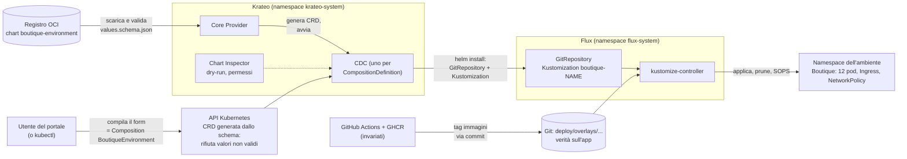

# Valutazione di Krateo PlatformOps

- **Data:** 2026-11-23
- **Versione documentata:** Krateo 3.0.0 (docs.krateo.io, versione predefinita al momento della lettura)
- **Stato degli artefatti:** blueprint concettuale. Niente è stato eseguito in un cluster Krateo (§5).

## 1. Sintesi e raccomandazione

**Non adottare Krateo ora per questo progetto; tenerlo come candidato per un secondo momento, a condizioni precise.**

- **Cosa darebbe:** un modo self-service di creare "un nuovo ambiente Boutique" compilando 8 parametri validati, con permessi minimi per ogni tipo di servizio (§2, §3). Il valore vero è nel portale e nel modello di ruoli, non nel deploy.
- **Cosa costa:** una piattaforma di almeno 12 vCPU e 16 GiB per sé (la doc lo dichiara), con un PostgreSQL gestito da CloudNativePG, tre Secret da creare a mano e un secondo livello di controllori sopra a Flux. Il cluster di questo progetto ha 6 CPU e 9,7 GiB, già al 56% di memoria con l'app e Prometheus.
- **Quando ha senso:** quando i team che chiedono ambienti sono più di uno e crearli oggi richiede una persona della piattaforma che copia un overlay. Con un solo operatore (questo progetto) Krateo aggiunge più parti mobili di quante ne tolga.
- **Come, se si procede:** Krateo crea solo gli **oggetti Flux** di un ambiente (`GitRepository`, `Kustomization`), e Flux continua a distribuire l'app. Questa è la divisione che il chart di `krateo/boutique-environment/` rappresenta. Passi in §7.

La raccomandazione dipende da un fatto che **non ho potuto provare**: che una Composition il cui chart genera oggetti Flux funzioni davvero con i permessi che Krateo calcola da solo (§6, rischio R2).

## 2. Cosa è Krateo (verificato sulla documentazione, non a memoria)

Letto il 2026-11-23, scaricando le pagine HTML e convertendole in testo (lettura integrale delle pagine elencate; non un riassunto di un modello):

| Pagina | Cosa ho preso |
|---|---|
| `how-to-guides/kco-operations/deploy-composition-definition` | Prerequisito: `values.schema.json` nella root del chart. Sorgenti: repository Helm, OCI, `.tgz`; registri privati con blocco `credentials`/`passwordRef`. Il Core Provider scarica il chart, valida lo schema, genera la CRD, crea i permessi e avvia il controllore |
| `key-concepts/kco/architecture`, `core-provider/overview`, `cdc/overview` | Tre attori: Core Provider (genera la CRD da ogni `CompositionDefinition` e avvia un controllore dedicato), CDC (gestisce le release Helm delle `Composition`), Chart Inspector (fa un dry-run del chart per calcolare i permessi) |
| `cdc/workflow`, `core-provider/security-design` | Prima di ogni install/upgrade il CDC genera un Role/ClusterRole minimo dal dry-run; un CDC e un ServiceAccount per ogni `CompositionDefinition` |
| `cdc/composition-status` | `Ready: True` significa solo che la release Helm è `deployed`, **non** che le risorse create siano sane |
| `cdc/release-naming`, `cdc/values-injection` | Nome della release = nome della Composition + `-` + 8 caratteri di UID, quindi massimo 44 caratteri; Krateo inietta `global.composition*` nei values; pausa con `krateo.io/paused` o `krateo.io/gracefully-paused` |
| `core-provider/version-management`, `kco-operations/*` | Aggiornamenti: completo, parallelo (due `CompositionDefinition`), selettivo (annotazione `krateo.io/desired-version`); cancellazione: prima le Composition, poi la definizione |
| `how-to-guides/install-krateo/installing-krateo`, `/` (home) | Installazione con `krateoctl`; tre Secret obbligatori prima (`jwt-sign-key`, `krateo-db`, `krateo-db-user`); PostgreSQL via CloudNativePG; requisiti: Kubernetes >= 1.31, **12 vCPU e 16 GiB**, StorageClass |
| `release-notes/release-note-3.0.0` | Rilascio 3.0.0 con modifiche incompatibili (etcd sostituito da PostgreSQL, nuovo installer `krateoctl`); da 2.7.x serve una migrazione guidata |
| `key-concepts/kco/troubleshooting` | Problemi tipici: `CompositionDefinition` che non diventa Ready, certificati del webhook, versione "vacuum" persa |
| `key-concepts/kog/oasgen-provider`, `provider-reference/github-provider-kog` | Lette il 2026-11-23, usate in §3.4. L'OASGen Provider genera CRD e un controllore (Rest Dynamic Controller) da una specifica OpenAPI 3.0/3.1; il provider GitHub ne è un'applicazione |
| `key-concepts/kcp/frontend/overview` (widget) | Letta il 2026-11-23, usata in §3.4. Il portale è fatto di widget, ciascuno una CRD con schema JSON; i dati arrivano da `RESTAction` |

In una frase: Krateo trasforma un **chart Helm con `values.schema.json`** in una **API Kubernetes versionata** (la CRD generata dallo schema) e mantiene ogni istanza di quell'API come release Helm, con permessi minimi e un portale sopra.

### Limiti di questa lettura

- **Non letto:** componenti FinOps, Kserve, autenticazione del portale, la pagina delle `RESTAction`, l'elenco completo dei widget, la guida d'uso e gli esempi reali dell'OASGen Provider, gli altri provider (solo GitHub letto), le guide di migrazione, la documentazione di `krateoctl`. Un blueprint del portale vero e proprio (la parte "form") non è disegnato qui.
- **Incoerenze nella doc, segnalate per non dare per certo ciò che la pagina non dice:**
  - il banner dice 3.0.0 ma la pagina Quickstart installa "3.0.0-rc1";
  - i requisiti dicono Kubernetes >= 1.31, la pagina di installazione e del Core Provider >= 1.30. Il nostro k3s è 1.36, quindi non cambia l'esito;
  - la doc non cita Flux da nessuna parte nelle pagine lette; gli esempi usano **Argo CD** (la Composition d'esempio ha un blocco `argocd:`). Nessuna pagina dice che Krateo e Flux siano compatibili o incompatibili.

## 3. Il golden path: "nuovo ambiente Boutique"

Oggi, creare un ambiente significa copiare `deploy/overlays/dev`, cambiare namespace, host, repliche e limiti, cifrare un Secret, aggiungere una `Kustomization` a `clusters/local/` e fare una PR. Il golden path la sostituisce con un form.

### 3.1 Parametri esposti

I parametri del piano di lavoro (nome servizio, namespace, ambiente, risorse, ingress host, repository, owner, tier) sono tutti campi di `values.yaml`, quindi diventano `spec` della Composition. Lo schema (`krateo/boutique-environment/values.schema.json`) li vincola.

| Parametro del piano | Campo `spec` | Vincolo nello schema | Dove finisce |
|---|---|---|---|
| nome servizio | `name` | DNS-1123, massimo 30 caratteri, obbligatorio | nome di `GitRepository` e `Kustomization` (`boutique-<name>`), namespace di default |
| namespace | `namespace` | DNS-1123, vuoto = `boutique-<name>` | sostituzione `${namespace}` nell'overlay |
| ambiente | `environment` | enum `dev`/`prod`, obbligatorio | percorso dell'overlay |
| risorse | `frontend.limits.cpu`, `.memory` | quantity Kubernetes | patch sul Deployment `frontend` |
| ingress host | `ingressHost` | nome DNS, vuoto = `boutique-<name>.localtest.me` | sostituzione `${ingress_host}` |
| repository | `repository.url`, `.branch`, `.secretName` | `ssh://` o `https://` | `GitRepository` |
| owner | `owner` | valore valido di etichetta, obbligatorio | etichetta `boutique.example/owner`, sostituzione `${owner}` |
| tier | `tier` | enum `best-effort`/`standard`/`critical`, obbligatorio | repliche di `frontend` e `productcatalogservice`: 1, 1, 2 |

**"Nome servizio" l'ho interpretato come nome dell'ambiente**, perché la Boutique ha 11 servizi fissi e creare un servizio nuovo è un altro caso d'uso (`docs/adding-new-microservice.md`). Le risorse sono esposte solo per il frontend: aprire i limiti di tutti i servizi renderebbe il form lungo quanto la base.

### 3.2 Cosa orchestra Krateo e cosa resta a Flux

| Aspetto | Krateo (CDC + Core Provider) | Flux (invariato) |
|---|---|---|
| Interfaccia e validazione dell'input | Sì: portale e CRD generata dallo schema; l'API server rifiuta valori fuori schema | No |
| Oggetti che descrivono l'ambiente | Sì: la release Helm contiene `GitRepository` e `Kustomization` | Li legge e li applica |
| Workload dell'applicazione (Deployment, Service, Ingress, NetworkPolicy, Secret) | **No** | Sì: `Kustomization` con `prune`, `wait`, SOPS |
| Contenuto dell'overlay (Git) | No | Sì: Git resta la verità sull'app |
| Permessi di chi crea ambienti | Sì: RBAC di Kubernetes, un CDC per definizione | No |
| Pipeline CI e immagini | No (il blueprint d'esempio della doc usa Argo CD e una pipeline di scaffolding, non la nostra CI) | No: GitHub Actions + GHCR restano come sono |
| Database/cloud esterni | Possibile in teoria (la doc dice "qualsiasi risorsa descrivibile in YAML"); **non necessario qui**, la Boutique ha solo Redis nel cluster | No |

Il confine che propongo è "Krateo possiede gli oggetti Flux, Flux possiede l'app". Così non ci sono due controllori sullo stesso oggetto, che sarebbe il difetto peggiore (il rischio analogo di `kubectl` contro Flux è descritto in `docs/runbook.md` §4).

### 3.3 Diagramma di integrazione

*Cosa è provato in questo diagramma:* i riquadri e le frecce di Flux, Git e CI esistono e sono quelli del repo (`docs/gitops.md`, `docs/ci.md`). *Cosa è una proposta non provata:* tutto ciò che sta nel riquadro Krateo e le due frecce che escono da `CDC` e dal registro. La forma degli oggetti Krateo viene dalla doc (§2).

### 3.4 Pipeline, database, servizi esterni, risorse cloud, catalogo

La traccia chiede come Krateo potrebbe "orchestrare o rappresentare" anche questi componenti. Dalle pagine lette (§2) risultano **due meccanismi**, e va tenuto distinto ciò che la doc dice da ciò che deduco io.

- **Composition (chart Helm).** Il chart può contenere qualsiasi risorsa Kubernetes, comprese le CRD di operatori terzi. È ciò che usa il blueprint di §3.2 per gli oggetti Flux.
- **OASGen Provider.** Da una `RestDefinition` che punta a una specifica OpenAPI 3.0/3.1 genera una CRD e un controllore dedicato, che crea, legge, aggiorna e cancella la risorsa su un'API REST esterna. La fonte di verità è la risorsa nel cluster, non il sistema esterno. Limiti dichiarati dalla doc: autenticazione solo **Bearer** o **Basic**; non supportati `number`, `nullable`, `anyOf`/`oneOf`/`not`, `pattern`, `minimum`/`maximum` e simili; i nomi dei campi devono essere coerenti tra le azioni, altrimenti serve un servizio wrapper (plugin).

| Componente | Come Krateo lo rappresenterebbe | Per la Boutique | Stato |
|---|---|---|---|
| **Pipeline CI** | `github-provider-kog` (costruito sull'OASGen) ha le risorse `Repo`, `Collaborator`, `TeamRepo`, `RunnerGroup` e `Workflow`. `Workflow` **lancia** un `workflow_dispatch` con degli input (solo creazione: niente lettura, update o cancellazione). Richiede un token Bearer in un Secret | Il form potrebbe creare il repository di un ambiente e avviare una pipeline. Oggi solo `release.yaml` ha `workflow_dispatch`: `build-images.yaml` andrebbe adattato. La CI resta GitHub Actions: Krateo la avvia, non la sostituisce | Descritto dalla doc, **non provato**; il provider si dichiara destinato a sostituire quello originale |
| **Database** | Nessun provider per database nelle pagine lette. Per Composition: includere nel chart la CRD di un operatore (la doc stessa usa CloudNativePG per il PostgreSQL di Krateo) | **Non serve**: la Boutique ha solo Redis nel cluster, senza persistenza (`docs/security.md` §3) | Ipotesi mia; richiede l'operatore già installato |
| **Servizio esterno con API REST** | `RestDefinition` su una sua specifica OpenAPI | Nessuno oggi | Vale solo se l'API rispetta i limiti sopra (autenticazione, tipi, coerenza dei nomi) |
| **Risorse cloud** | Nessun provider cloud letto (della famiglia ho visto solo GitHub; Azure DevOps compare come riferimento CRD, non letto). Via OASGen solo se l'API ha autenticazione Bearer/Basic; la doc cita un wrapper per aggiungere la firma delle richieste (`request signing`), e deduco che servirebbe per schemi come AWS SigV4 (l'esempio è mio) | Nessuna: l'ambiente è un k3d locale | **Non verificato.** Idee come usare Crossplane o ACK dentro un chart sono mie, non nella doc |
| **Catalogo** | Le pagine lette non descrivono un catalogo di template. Descrivono widget composabili: un `Table` alimentato da una `RESTAction` può elencare oggetti Kubernetes (l'esempio della doc elenca i namespace) | Un elenco degli ambienti Boutique (le `Composition`, con `owner` e `tier`) si potrebbe costruire così | Ipotesi mia; non so se il portale offra un catalogo già pronto |
| **Governance** | Permessi minimi per definizione (Chart Inspector) e RBAC; l'OASGen genera anche RBAC per le sue risorse | Già in §6; l'etichetta `owner` è un'informazione, non una policy | Parziale |

**Risposta breve:** secondo la doc Krateo può rappresentare come risorse Kubernetes qualsiasi cosa descritta da un chart o da un'API REST con autenticazione Bearer/Basic. Per la pipeline c'è un caso concreto (il provider GitHub). Per database e cloud è **possibile in principio**, ma nelle pagine lette non c'è un provider pronto e non l'ho provato. Per questo la valutazione non lo conta tra i benefici di questo progetto.

## 4. Artefatti e cosa è stato verificato

Cartella `krateo/` (vedi anche `krateo/README.md`):

- `boutique-environment/`: chart wrapper (`Chart.yaml`, `values.yaml`, **`values.schema.json` nella root**, due template).
- `compositiondefinition.yaml`: registrazione del chart.
- `composition.example.yaml`: un ambiente `prod`, tier `critical`.

**Verificato il 2026-11-23, senza Krateo:**

| Controllo | Esito |
|---|---|
| `helm lint krateo/boutique-environment` | passa (solo il suggerimento "icon is recommended") |
| Schema: 8 valori sbagliati (tier `gold`, owner vuoto, ambiente `staging`, nome con `_`, nome di 36 caratteri, campo non previsto, CPU `lots`, URL `ftp://`) | tutti rifiutati da `helm template` con il messaggio dello schema |
| `helm template` con il tier `critical` | repliche 2 per frontend e productcatalogservice, host e namespace personalizzati sostituiti |
| `kubeconform -strict` con gli schemi dei CRD di Flux (catalogo datree) | 2 risorse valide, 0 errori |
| Le patch del chart applicate con `kustomize build` sull'overlay `prod` esistente | frontend e productcatalogservice a 2 repliche, limiti del frontend 200m/128Mi (sovrascrivono quelli di prod) |

**Non verificato (e perché):**

- **Tutto ciò che sta dentro Krateo.** Non c'è un cluster Krateo: mancano le risorse (§5) e non l'ho installato. Non so quindi se il Core Provider accetta questo chart, se la CRD generata è quella attesa, se il `kind` si chiama davvero `BoutiqueEnvironment` (dedotto per analogia dall'esempio della doc), né se il CDC riesce a creare oggetti in `flux-system`.
- **L'overlay parametrico non esiste.** Il chart punta a `deploy/overlays/environment-dev` ed `environment-prod`, con `${namespace}`, `${ingress_host}` come sostituzioni. Oggi gli overlay `dev` e `prod` hanno namespace e host scritti dentro. Senza quell'overlay il chart genera una `Kustomization` che non trova il percorso. È il pezzo di lavoro più grosso (§7, passo 1) e non l'ho fatto: il feature freeze è vicino.
- **Il Secret Redis di un nuovo ambiente.** Ogni ambiente ha il suo `redis-auth.enc.yaml` cifrato con SOPS e committato. Il form non può crearlo; nessuna pagina letta dice che Krateo scriva file cifrati in un repo esistente. Da risolvere a parte (§6, R4).
- Il chart non è pubblicato su GHCR; l'URL OCI è un esempio.

## 5. Perché non c'è un PoC

Il piano lo prevedeva "solo se avanza tempo". Non l'ho fatto per ragioni misurate, non per mancanza di tempo:

- **Risorse.** La doc chiede 12 vCPU e 16 GiB. Il cluster k3d ha un nodo da 6 CPU e 9,7 GiB di RAM nella VM Docker, con 897 mCPU e 5,6 GiB già usati (`kubectl top nodes`, 2026-11-23) da app, Flux e Prometheus. Il requisito è un minimo dichiarato per una piattaforma completa (con CloudNativePG e portale), non misurato da me: non so se una configurazione ridotta basterebbe.
- **Stabilità.** Grafana ha già portato questo nodo al limite una volta (`docs/observability.md` §8). Aggiungere una piattaforma pesante nello stesso cluster metterebbe a rischio la demo.
- **Alternativa possibile:** un secondo cluster usa e getta (la doc propone `kind` e uno script) su una macchina più grande, solo per la prova. Non fatto.

## 6. Benefici, prerequisiti, limiti, rischi

### Benefici (dalla doc, valutati sul nostro caso)

- **Validazione all'ingresso:** lo schema diventa la CRD, quindi un `tier: gold` viene rifiutato dall'API server, non scoperto dopo un deploy fallito. `helm template` mi ha mostrato lo stesso rifiuto in locale (§4); per Krateo la doc dice che la validazione avviene alla `kubectl apply` (`architecture`).
- **Permessi minimi automatici** per ogni tipo di ambiente (Chart Inspector): più sicuro di dare a una pipeline `cluster-admin`.
- **Un'API uniforme** (`kubectl` e portale equivalenti: è un principio dichiarato dalla doc) e ciclo di vita completo (versioni, pausa, cancellazione ordinata).
- **Self-service:** chi non conosce Kustomize e Flux crea un ambiente senza toccare Git.

### Prerequisiti

1. Cluster con >= 12 vCPU, 16 GiB, StorageClass (doc), Kubernetes >= 1.31 (nostro k3s 1.36: ok).
2. `krateoctl`, tre Secret (`jwt-sign-key`, `krateo-db`, `krateo-db-user`) e un PostgreSQL CNPG da dimensionare.
3. Un registro raggiungibile dal cluster per il chart (OCI, Helm repo o `.tgz`) e un modo di pubblicarlo dalla CI.
4. I CRD di Flux già installati (lo sono) e un Role che permetta al CDC di creare `GitRepository`/`Kustomization` in `flux-system`: il Chart Inspector lo calcolerebbe dal dry-run, ma va provato.
5. Overlay parametrico `environment-*` e una soluzione per il Secret SOPS di ogni ambiente.

### Limiti

- **Un solo livello di astrazione utile.** Il chart wrapper espone ciò che io decido; tutto il resto della Boutique (11 servizi, NetworkPolicy, probe) resta in Git. Non è un limite di Krateo, ma significa che il form non sostituisce la conoscenza dell'app.
- **`Ready` non è salute.** Una Composition pronta dice solo che Helm ha installato gli oggetti Flux (`cdc/composition-status`). Se la `Kustomization` non riesce ad applicare l'overlay, la Composition resta `Ready: True`. Lo stato dell'app va letto da Flux e da Prometheus: serve una regola di alert su `Kustomization` non pronta.
- **Il nome della Composition ha 44 caratteri al massimo.**
- **Ciclo di vita doppio.** Per cancellare un ambiente bisogna cancellare la Composition (Helm toglie gli oggetti Flux, e Flux con `prune: true` toglie l'app, se la finalizzazione va in quell'ordine: **non provato**).

### Rischi

| # | Rischio | Gravità | Mitigazione |
|---|---|---|---|
| R1 | Peso della piattaforma sul nostro nodo: demo instabile | alta, sicura se installata qui | niente PoC sul cluster della demo; cluster separato |
| R2 | Krateo e Flux non provati insieme: la doc usa Argo CD negli esempi e non cita Flux. Il CDC potrebbe non avere i permessi (o non poterli calcolare) per creare oggetti Flux | alta sulla decisione | PoC minimo prima di decidere (§7, passo 2) |
| R3 | Due controllori sullo stesso oggetto: Helm (CDC, ogni 3 min per default) contro chi modifica a mano `Kustomization` | media | cambiare gli ambienti solo dalla Composition; Krateo ha il suo self-healing del drift (doc: `cdc/workflow`) |
| R4 | Il Secret SOPS di un ambiente nuovo non nasce dal form | media | Secret condiviso per classe di ambiente, o un provider esterno di secret; da decidere, non risolto |
| R5 | Verità spezzata: le Composition non stanno in Git se create dal portale | media | tenere i `Composition` YAML in Git e farli applicare da Flux (`dependsOn` sulla `CompositionDefinition`); si perde parte del self-service, si tiene la tracciabilità |
| R6 | Versione giovane: la 3.0.0 è un salto di major con modifiche incompatibili e migrazione obbligatoria dalla 2.7.x; la stessa doc ha ancora un riferimento a `rc1` | media | fissare la versione, leggere le note di rilascio ad ogni aggiornamento |
| R7 | Debito di competenza: tre nuovi tipi di oggetti (`CompositionDefinition`, CRD generata, CDC), un'altra superficie di troubleshooting | media | estendere `docs/runbook.md` con la pagina di troubleshooting di Krateo (§2) |

## 7. Tre livelli: PoC, blueprint, adozione reale

| Livello | Cosa significa | Stato in questo progetto |
|---|---|---|
| **Blueprint** | disegno + YAML concettuale + controlli statici | **Fatto** (§3, §4). È ciò che consegna la fase 9 |
| **PoC** | installare Krateo su un cluster usa e getta, registrare `boutique-environment`, creare una Composition e vedere comparire un ambiente | **Non fatto.** Richiede risorse che il nodo non ha (§5) e l'overlay parametrico |
| **Adozione reale** | Krateo come punto d'ingresso per i team, con portale, ruoli, backup di PostgreSQL, aggiornamenti | **Non raccomandata ora** (§1) |

### Se si procede: ordine dei passi

1. **Overlay parametrico** `deploy/overlays/environment-{dev,prod}` con `${namespace}`, `${ingress_host}`, `${owner}`, `${tier}` (con valori di default in `${var:=default}` così `kustomize build` e `kubeconform` in CI continuano a passare) e un Secret SOPS per ambiente. Si può fare e provare **senza Krateo**, applicando a mano una `Kustomization` come quella che il chart genera: è il controllo che manca per dire che il chart è giusto.
2. **PoC minimo** su un cluster separato: Krateo 3.0.0 con `krateoctl`, chart pubblicato su GHCR, una Composition. Domanda a cui risponde: R2.
3. **Se R2 ha esito positivo:** avviare con un solo team e un solo tier, tenendo le Composition in Git (R5).
4. **Criterio di uscita:** se dopo un trimestre gli ambienti nuovi restano meno di tre, o se la manutenzione di Krateo costa più di quello che fa risparmiare, tornare a "overlay copiato + PR".

## 8. Come questo documento è stato prodotto

- Lettura delle pagine dal sito ufficiale e confronto con il repo: l'AI (Claude Code) ha scaricato e letto le pagine (§2), ha scritto chart e documento, e ha eseguito i controlli di §4. Il registro è in `AI-LOG.md` (AI-19).
- **Quello che l'AI ha corretto di sé:** una ricerca preliminare nelle pagine non ha trovato nessun riferimento a Flux, quindi la raccomandazione si basa su un'assenza. Le pagine che non ho letto potrebbero contenerlo (§2, "Limiti di questa lettura").
- **Da fare da me, prima di fidarmi:** rileggere dal sito le pagine di §2 su cui la raccomandazione poggia (requisiti, `architecture`, `deploy-composition-definition`) e controllare che le cifre (12 vCPU, 16 GiB) siano ancora quelle.
